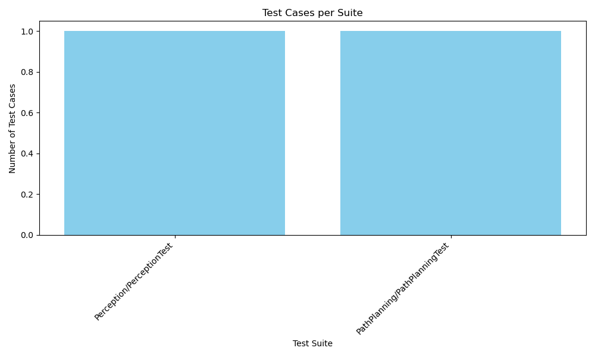
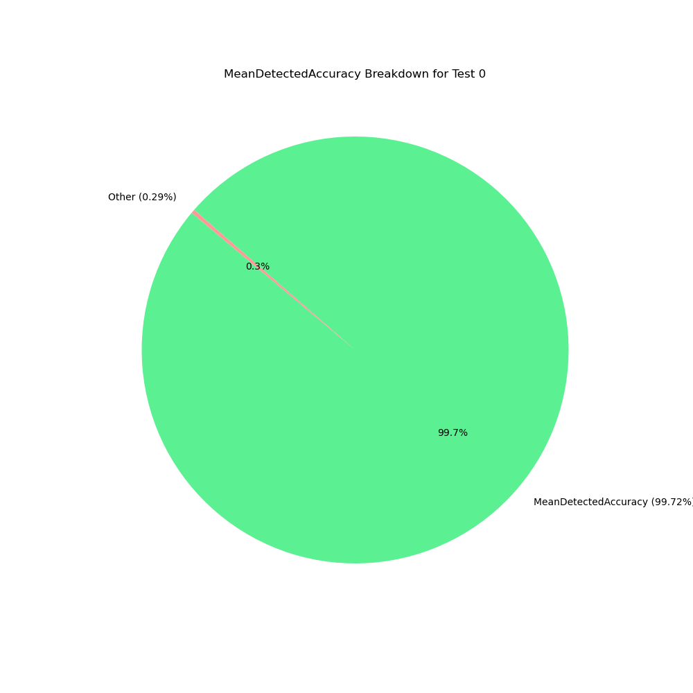
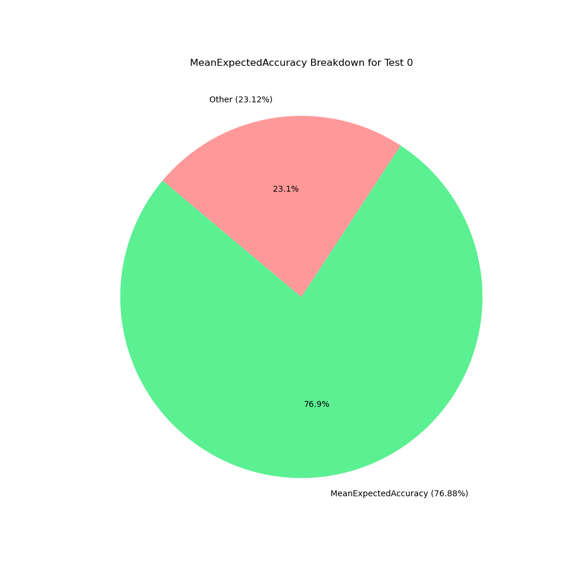

# ❌ Test Report

**Total Tests**: 2  

**Failures**: 2  

**Errors**: 0  

**Disabled**: 0  

**Time**: 22.94s  

**Timestamp**: 2026-04-07T17:10:54

---

## 📈 Test Distribution

---

## 🧪 Detailed Results

### ❌ Suite: **Perception/PerceptionTest**
- Tests: 1, Failures: 1, Errors: 0, Time: 11.84s
  - ❌ **PerceptionAccuracyTest/0** (perception_tests.Perception/PerceptionTest) - 11.84s
    - **Test Number**: 0
    - **MeanDetectedAccuracy**: 0.99715
      
    - **MeanExpectedAccuracy**: 0.76875
      
    - **Failure**: ****
/home/javi/workspace/src/DRIVERLESS_TEST/DRIVERLESS_TESTS/perception_tests/tests/perception_test.cpp:483
Expected: (mean_expected_accuracy) >= (cfg.kMinExpectedAccuracy), actual: 0.768751 vs 0.9
Mean expected accuracy too low!
    - **Properties:**

      | Key | Value |
      |-----|-------|
      | MeanDetectedAccuracy | 0.99715 |
      | MeanExpectedAccuracy | 0.76875 |

### ❌ Suite: **PathPlanning/PathPlanningTest**
- Tests: 1, Failures: 1, Errors: 0, Time: 11.10s
  - ❌ **PlanningAccuracyTest/0** (planning_tests.PathPlanning/PathPlanningTest) - 11.10s
    - **Failure**: ****
/home/javi/workspace/src/DRIVERLESS_TEST/DRIVERLESS_TESTS/planning_tests/tests/planning_test.cpp:370
Expected: (mean_detected_accuracy) >= (kMinDetectedAccuracy), actual: 0.410474 vs 0.8
Mean detection accuracy too low!
    - **Properties:**

      | Key | Value |
      |-----|-------|
      | MeanDetectedAccuracy | 0.41047 |
